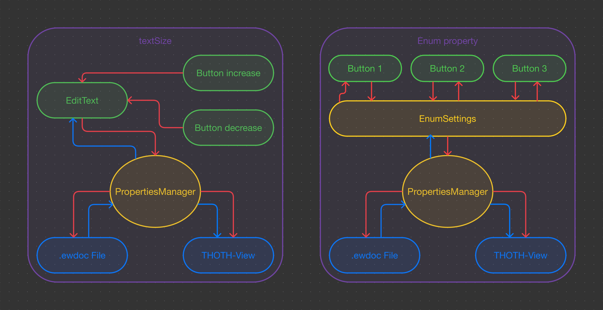

# Code structure

This documentation aims to increase the understanding of the code, by providing some fluid diagrams. The goodnotes files are the original files, in case you also use Goodnotes. Unfortunately this are my private notes, so they are in German, my native language.

## Properties
This diagram shows, how changing values in the properties fragment are passed between UI components and storage.

